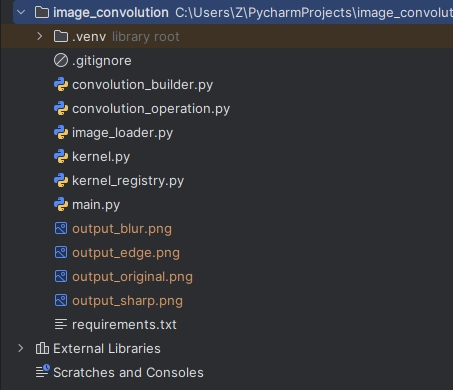
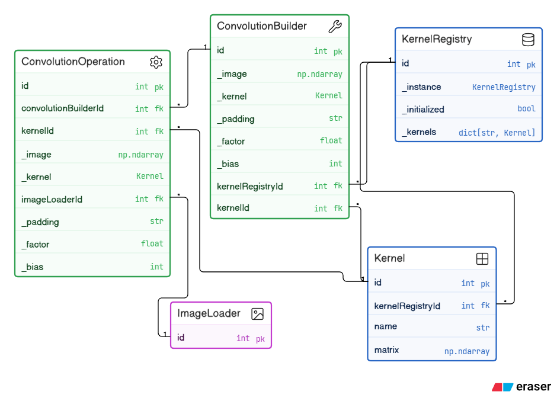
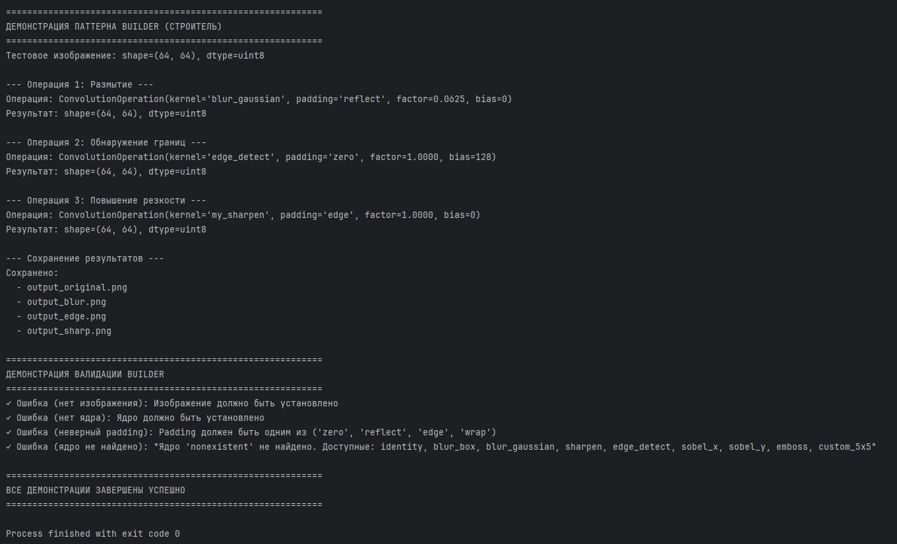

# Отчет к практической работе № 1

### Цель работы

реализуйте решение задачи из предметной области с использованием паттернов «Строитель» или «Одиночка».

## **Ход работы:**

Вариант 5.

Разработка приложения «Свертка изображения».

Одиночка – порождающий паттерн проектирования, который гарантирует, что у класса есть только один экземпляр, и предоставляет к нему глобальную точку доступа.

Строитель – порождающий паттерн, который позволяет создавать сложные объекты пошагово. Строитель даёт возможность использовать один и тот же код строительства для получения разных представлений объекта.

Свертка изображения (image convolution) – это фундаментальная операция цифровой обработки изображений, при которой к каждому пикселю изображения применяется ядро (матрица весов), определяющее, как значение пикселя зависит от значений соседних пикселей.

Для пикселя с координатами (i, j) новое значение вычисляется как:

result[i,j] = Σ Σ kernel[m,n] * image[i+m, j+n], где kernel – матрица ядра свертки.

В данной программе паттерн «Одиночка» – это класс KernelRegistry. В приложении используется набор предопределенных ядер свертки (identity, blur, sharpen, edge_detect и др.). Эти ядра должны быть доступны из любой части программы, но при этом не должно быть дублирования данных.

KernelRegistry должен создавать единственный экземпляр реестра при первом обращении и хранить словарь ядер с именами в качестве ключей.

Паттерн «Строитель» – это класс ConvolutionBuilder. Операция свертки имеет множество параметров (5 и более), которые могут комбинироваться по-разному. Прямая передача всех параметров в конструктор делает код нечитаемым и подверженным ошибкам.

ConvolutionBuilder позволяет задавать параметры пошагово через цепочку вызовов и выполняет валидацию обязательных параметров в методе.

Диаграмма включает следующие классы:

Kernel – базовый класс, представляющий ядро свертки (матрицу весов).

KernelRegistry (Singleton) – реестр ядер, хранит коллекцию объектов Kernel.

ConvolutionBuilder (Builder) – строитель операции свертки, пошагово конфигурирует параметры.

ConvolutionOperation (Product) – продукт строителя, выполняет фактическую операцию свертки.

ImageLoader – утилитарный класс для загрузки и сохранения изображений.

Отношения между классами:

KernelRegistry агрегирует множество объектов Kernel (1 ко многим);
ConvolutionBuilder использует KernelRegistry для получения ядер по имени;
ConvolutionBuilder создает объекты ConvolutionOperation;
ConvolutionOperation использует Kernel для выполнения свертки;
ConvolutionOperation использует ImageLoader для сохранения результатов.
## **Исходный код:**

[https://github.com/kkirshenko/image_convolution](https://github.com/kkirshenko/image_convolution)

### Вывод

** **реализовано решение задачи из предметной области с использованием паттернов «Строитель» или «Одиночка».

