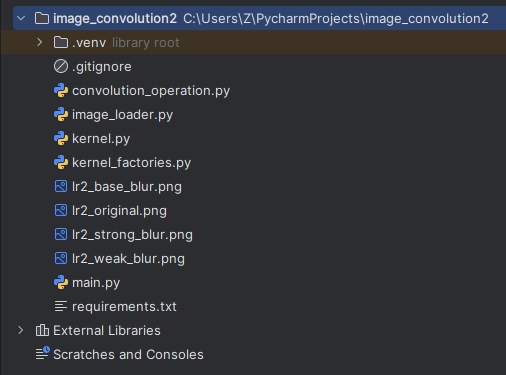
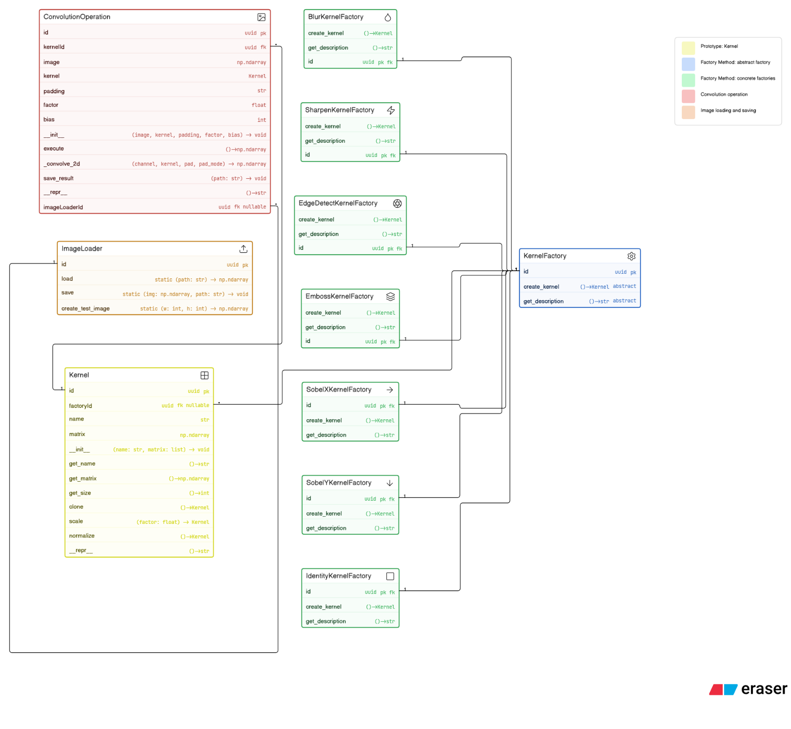
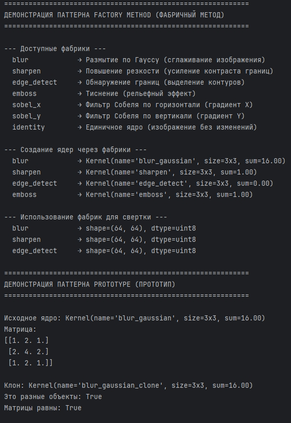
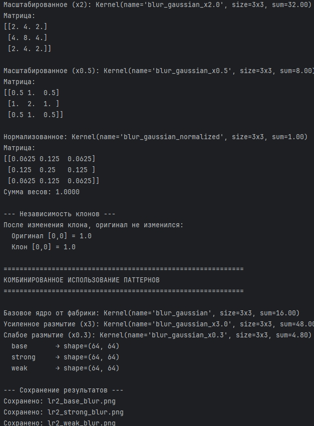
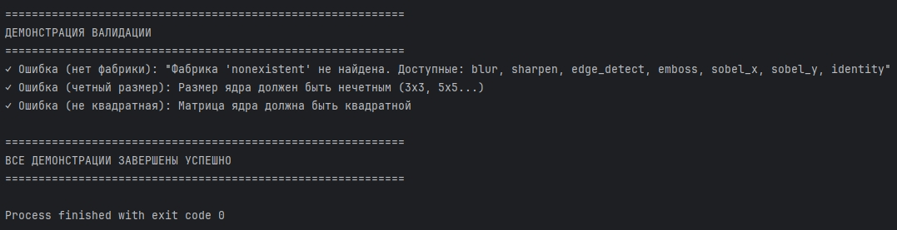

# Отчет к практической работе № 2

### Цель работы

реализуйте решение задачи из предметной области с использованием 2 паттернов из списка: «Абстрактная фабрика», «Фабричный метод», «Прототип».

## **Ход работы:**

Вариант 5.

Разработка приложения «Свертка изображения».

Из трех предложенных паттернов (Абстрактная фабрика, Фабричный метод, Прототип) для задачи свертки изображения наиболее естественно подходят Фабричный метод и Прототип.

Абстрактная фабрика не используется т.к. создает семейства связанных объектов. В нашем случае ядро – это один объект, а не семейство. Фабричный метод подходит лучше.

Свертка изображения (image convolution) – это фундаментальная операция цифровой обработки изображений, при которой к каждому пикселю изображения применяется ядро (матрица весов), определяющее, как значение пикселя зависит от значений соседних пикселей.

Диаграмма включает следующие классы:

Kernel (паттерн Прототип) – базовый класс ядра свертки. Содержит матрицу весов и методы клонирования: clone(), scale(factor), normalize(), позволяющие создавать модифицированные копии без знания внутренней структуры объекта.

KernelFactory (паттерн Фабричный метод) – абстрактная фабрика с двумя абстрактными методами: create_kernel() и get_description().

Конкретные фабрики: BlurKernelFactory, SharpenKernelFactory, EdgeDetectKernelFactory, EmbossKernelFactory, SobelXKernelFactory, SobelYKernelFactory, IdentityKernelFactory – наследуются от KernelFactory и реализуют создание конкретных ядер.

ConvolutionOperation – продукт, выполняющий операцию свертки. Использует Kernel и ImageLoader.

ImageLoader – утилитарный класс для загрузки и сохранения изображений.

Отношения:

Наследование: все конкретные фабрики → KernelFactory.
Создание: KernelFactory → Kernel.
Ассоциация: ConvolutionOperation → Kernel, ConvolutionOperation → ImageLoader.
## **Исходный код:**

[https://github.com/kkirshenko/image_convolution](https://github.com/kkirshenko/image_convolution)

### Вывод

** **реализовано решение задачи из предметной области с использованием 2 паттернов: «Фабричный метод» и «Прототип».

