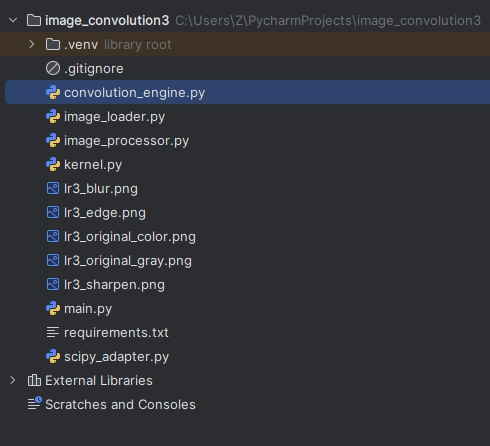
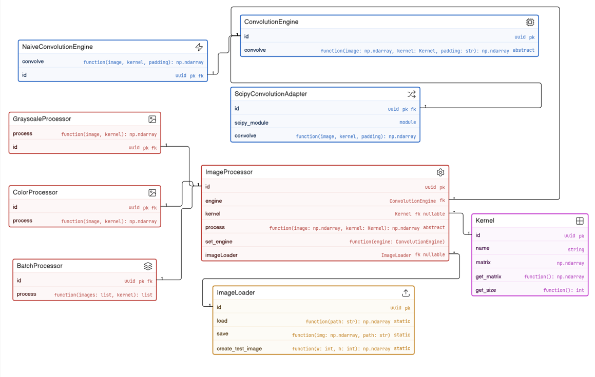
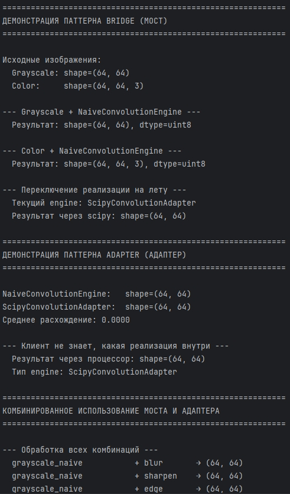
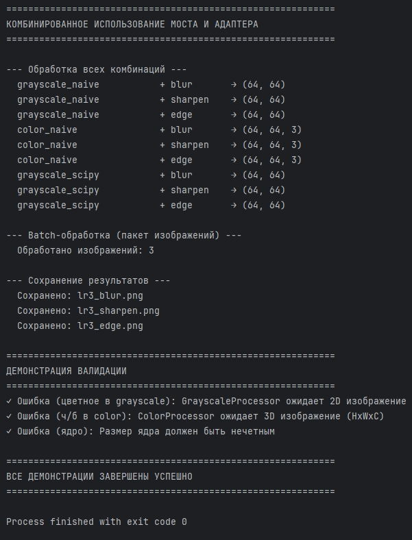

# Отчет к практической работе № 3

### Цель работы

реализуйте решение задачи из предметной области с использованием паттернов из списка: «Адаптер», «Мост».

## **Ход работы:**

Вариант 5.

Разработка приложения «Свертка изображения».

Паттерн Мост (Bridge).

В приложении есть две независимые оси изменений:

Абстракция – что обрабатываем: черно-белое изображение, цветное, пакет изображений.

Реализация – как выполняем свертку: наивный алгоритм на numpy, через scipy.signal, через OpenCV.

Если делать наследование, получится комбинаторный взрыв классов: NaiveGrayscaleProcessor, ScipyColorProcessor и т.д. Разделяется абстракция (ImageProcessor) и реализация (ConvolutionEngine), связываются через композицию. Это позволяет независимо добавлять новые типы обработки и новые алгоритмы свертки.

Паттерн Адаптер (Adapter).

Используется когда нужна быстрая свертка, но её интерфейс несовместим с нашим ConvolutionEngine (другие параметры, другой способ передачи ядра и padding).

Потому необходимо создать класс ScipyConvolutionAdapter, который оборачивает библиотеку и приводит его к интерфейсу ConvolutionEngine. Клиентский код работает только с абстракцией и не знает, что внутри – scipy.

Диаграмма включает следующие классы:

ConvolutionEngine – абстракция движка свертки с абстрактным методом convolve().

NaiveConvolutionEngine – конкретная реализация движка свертки наивным алгоритмом.

ScipyConvolutionAdapter – паттерн Адаптер. Адаптирует интерфейс библиотеки SciPy (scipy_module) к интерфейсу ConvolutionEngine, позволяя использовать оптимизированную свертку из SciPy без изменения клиентского кода.

ImageProcessor – абстрактный обработчик изображений. Содержит ссылку на ConvolutionEngine (реализация) и ImageLoader.

GrayscaleProcessor, ColorProcessor, BatchProcessor – конкретные обработчики для ч/б изображений, цветных изображений и пакетной обработки соответственно.

Kernel – класс ядра свертки с матрицей весов.

ImageLoader – утилитарный класс для загрузки и сохранения изображений.

Отношения:

Наследование: NaiveConvolutionEngine и ScipyConvolutionAdapter → ConvolutionEngine.
Наследование: GrayscaleProcessor, ColorProcessor, BatchProcessor → ImageProcessor.
Ассоциация: ImageProcessor → ConvolutionEngine (агрегация, паттерн Мост).
Ассоциация: ImageProcessor → Kernel, ImageProcessor → ImageLoader.

## **Исходный код:**

[https://github.com/kkirshenko/image_convolution](https://github.com/kkirshenko/image_convolution)

### Вывод

** **реализовано решение задачи из предметной области с использованием паттернов из списка: «Адаптер», «Мост».

