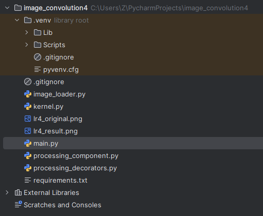
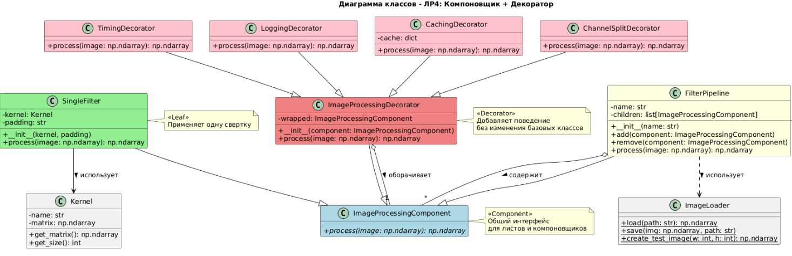
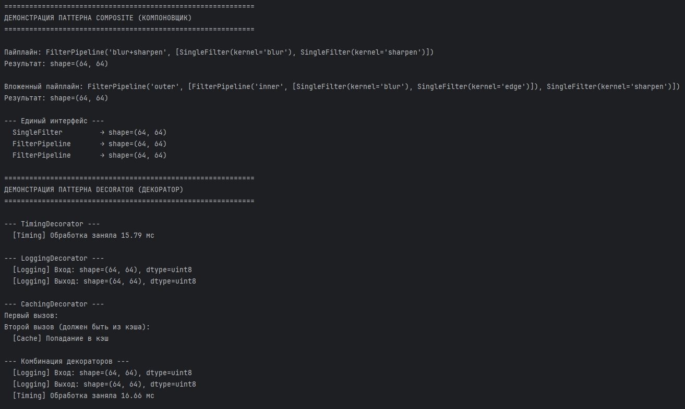
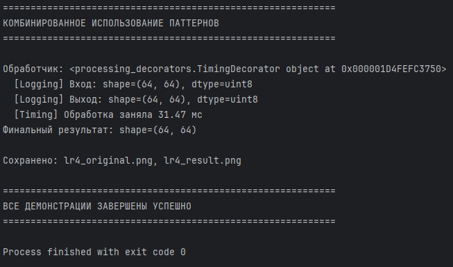

# Отчет к практической работе № 4

### Цель работы

реализуйте решение задачи из предметной области с использованием паттернов из списка: «Компоновщик», «Декоратор».

## **Ход работы:**

Вариант 5.

Разработка приложения «Свертка изображения».

Компоновщик (Composite) реализован через иерархию ImageProcessingComponent → SingleFilter (лист) и FilterPipeline (компоновщик).

Пайплайн хранит список компонентов и применяет их последовательно, при этом пайплайны могут быть вложенными друг в друга. Клиент работает с листом и компоновщиком через единый интерфейс process(image), что упрощает код и позволяет строить произвольные деревья операций обработки.

Декоратор (Decorator) реализован через базовый класс ImageProcessingDecorator, который оборачивает ImageProcessingComponent и делегирует ему вызов process(). Конкретные декораторы (TimingDecorator, LoggingDecorator, CachingDecorator, ChannelSplitDecorator) добавляют новое поведение – замер времени, логирование, кэширование, поканальную обработку – без изменения базовых классов. Декораторы можно комбинировать в произвольных сочетаниях.

Composite оборачивается декораторами, что даёт гибкую систему: можно собрать любую цепочку фильтров и добавить к ней логирование, замеры и кэширование без изменения кода самих фильтров.

Диаграмма включает следующие классы:

ImageProcessingComponent – абстрактный компонент, базовый интерфейс для всех элементов обработки. Определяет единственный метод process(image: np.ndarray), который должны реализовать все конкретные классы.

SingleFilter – лист в структуре Компоновщика. Применяет одну свертку с заданным ядром (Kernel) и типом padding. Содержит поля _kernel и _padding, реализует метод process().

FilterPipeline (Компоновщик) — компоновщик, хранит коллекцию дочерних компонентов (children: list[ImageProcessingComponent]) и применяет их последовательно. Предоставляет методы add(), remove() для управления дочерними элементами и process() для обработки изображения через всю цепочку.

ImageProcessingDecorator (Декоратор) – базовый декоратор, оборачивает компонент (wrapped: ImageProcessingComponent) и делегирует ему вызов process(). Основа для всех конкретных декораторов.

Конкретные декораторы:

TimingDecorator – замеряет время выполнения обработки
LoggingDecorator – логирует входные и выходные данные
CachingDecorator – кэширует результаты по хэшу изображения
ChannelSplitDecorator – применяет операцию к каждому каналу RGB отдельно
Kernel – класс ядра свертки с полями name и matrix, методами get_matrix() и get_size().

ImageLoader – утилитарный класс для загрузки, сохранения и создания тестовых изображений.

Отношения:

Наследование: SingleFilter и FilterPipeline реализуют интерфейс ImageProcessingComponent.
Наследование: Все конкретные декораторы наследуются от ImageProcessingDecorator.
Композиция (Composite): FilterPipeline содержит коллекцию ImageProcessingComponent (отношение «содержит»).
Декорирование: ImageProcessingDecorator оборачивает ImageProcessingComponent (отношение «оборачивает»).
Использование: SingleFilter использует Kernel для получения матрицы свертки.
Использование: FilterPipeline использует ImageLoader для работы с изображениями.
## **Исходный код:**

[https://github.com/kkirshenko/image_convolution](https://github.com/kkirshenko/image_convolution)

### Вывод

** **реализовано решение задачи из предметной области с использованием паттернов из списка: «Компоновщик», «Декоратор».

