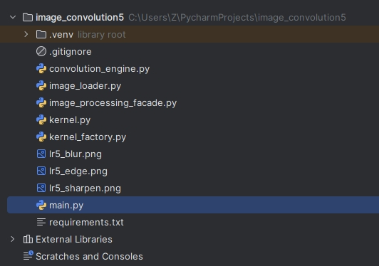
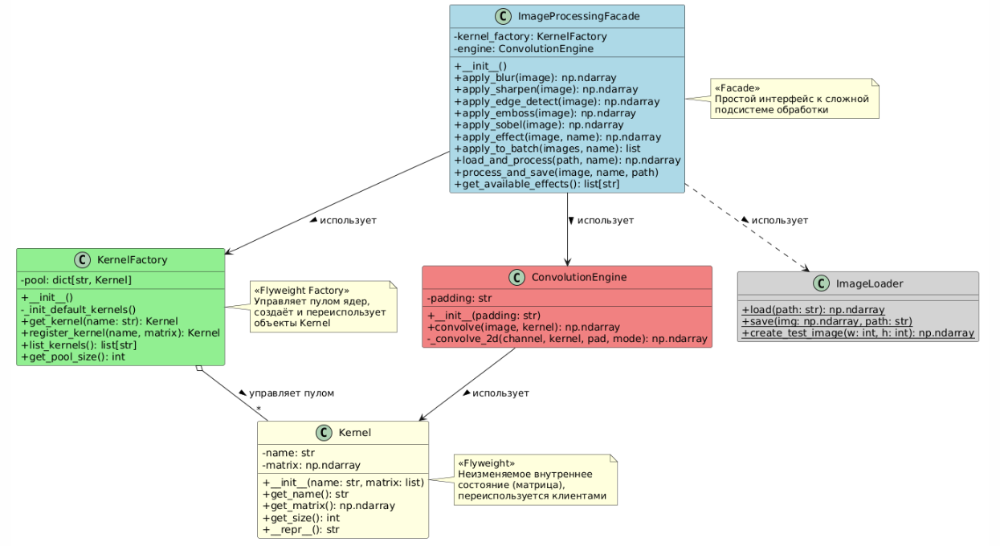
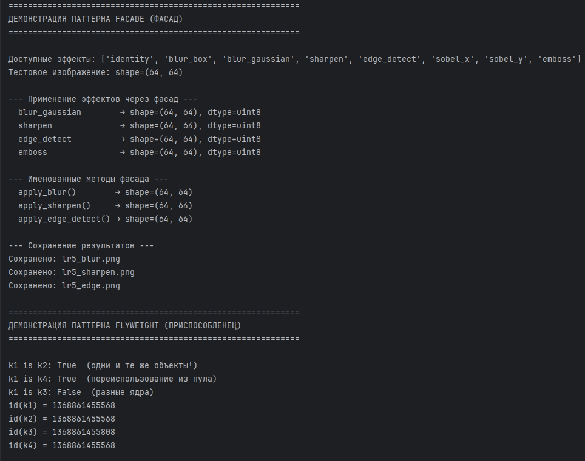
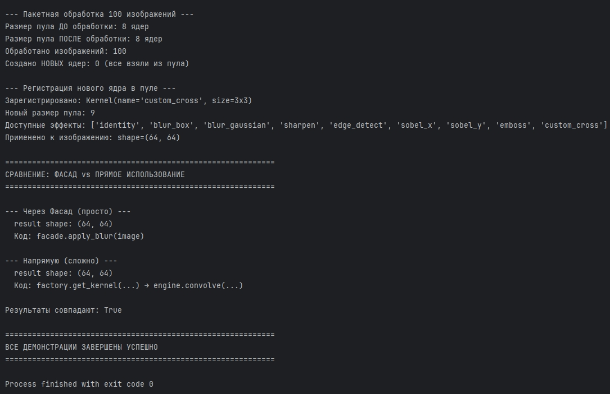

# Отчет к практической работе № 5

### Цель работы

реализуйте решение задачи из предметной области с использованием паттернов из списка: «Фасад», «Приспособленец».

## **Ход работы:**

Вариант 5.

Разработка приложения «Свертка изображения».

Паттерн «Фасад» (Facade).

Подсистема обработки изображений состоит из множества классов (Kernel, KernelFactory, ConvolutionEngine, ImageLoader, padding-стратегии). Клиенту приходится знать их все, правильно создавать и связывать – это сложно и подвержено ошибкам.

Потому класс ImageProcessingFacade предоставляет простой интерфейс с методами вида apply_blur(image), apply_sharpen(image), apply_effect(image, name). Внутри он сам создаёт ядра, настраивает движок и возвращает результат.

Паттерн «Приспособленец» (Flyweight).

При пакетной обработке множества изображений одно и то же ядро (например, blur_gaussian) используется сотни раз. Создавать новый объект Kernel каждый раз – трата памяти и времени.

Поэтому KernelFactory хранит пул уже созданных ядер. При запросе ядра по имени возвращает существующий экземпляр. Ядро – это Flyweight-объект с общим (неизменяемым) внутренним состоянием (матрицей).

Диаграмма включает следующие классы:

Kernel (Приспособленец) – хранит неизменяемое внутреннее состояние (матрицу весов). Объекты Kernel создаются один раз и переиспользуются множеством клиентов, что экономит память при пакетной обработке.

KernelFactory (Фабрика приспособленцев) – управляет пулом ядер (pool: dict[str, Kernel]). При запросе ядра по имени возвращает существующий экземпляр из пула, а при необходимости создаёт новый и сохраняет в пул. Предоставляет методы get_kernel(), register_kernel(), list_kernels(), get_pool_size().

ConvolutionEngine – движок свертки, выполняет фактическую операцию свертки изображения с заданным ядром и режимом padding. Содержит метод convolve(image, kernel) и вспомогательный _convolve_2d().

ImageProcessingFacade (Фасад) – предоставляет простой интерфейс к сложной подсистеме обработки изображений. Скрывает работу с KernelFactory, ConvolutionEngine и ImageLoader. Предоставляет методы apply_blur(), apply_sharpen(), apply_edge_detect(), apply_emboss(), apply_sobel(), универсальный apply_effect(), пакетную обработку apply_to_batch(), работу с файлами load_and_process() и process_and_save().

ImageLoader – утилитарный класс для загрузки, сохранения и создания тестовых изображений.

Отношения:

Агрегация: KernelFactory управляет пулом объектов Kernel (отношение «управляет пулом», 1 ко многим).
Использование: ImageProcessingFacade использует KernelFactory для получения ядер.
Использование: ImageProcessingFacade использует ConvolutionEngine для выполнения свертки.
Использование: ConvolutionEngine использует Kernel для получения матрицы весов.
Зависимость: ImageProcessingFacade использует ImageLoader для работы с файлами (пунктирная стрелка).
## **Исходный код:**

[https://github.com/kkirshenko/image_convolution](https://github.com/kkirshenko/image_convolution)

### Вывод

** **реализовано решение задачи из предметной области с использованием паттернов из списка: «Фасад», «Приспособленец».

