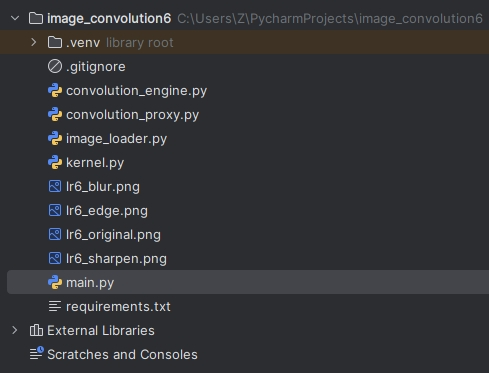
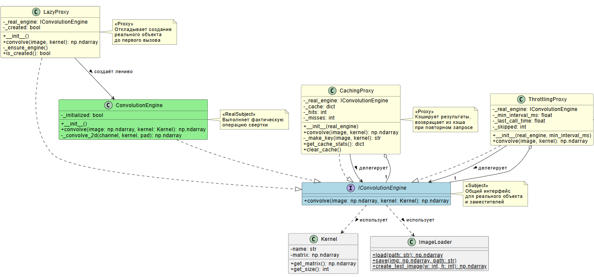
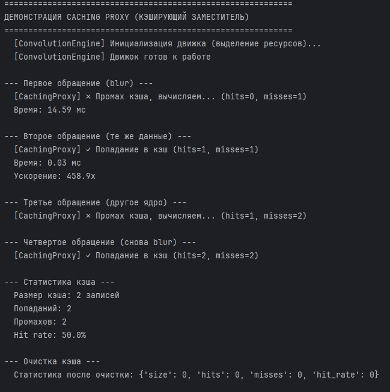
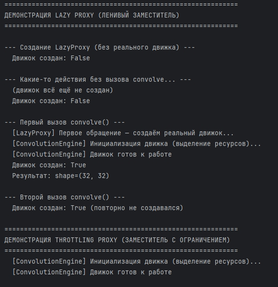
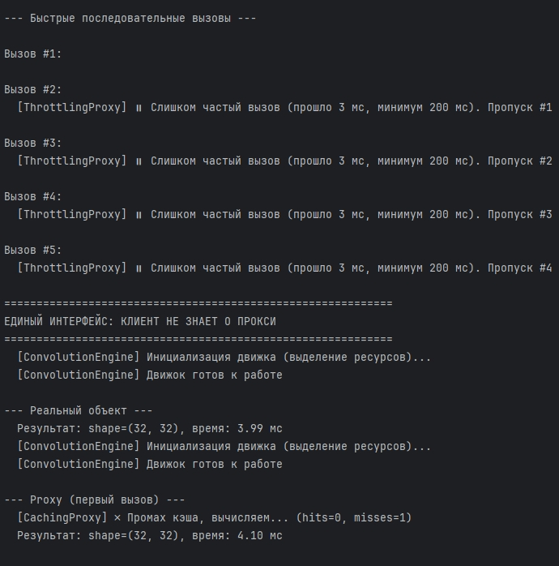
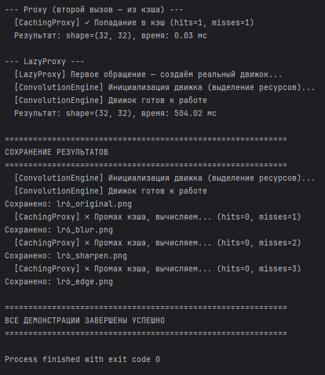

# Отчет к практической работе № 6

### Цель работы

реализуйте решение задачи из предметной области с использованием паттерна «Заместитель».

## **Ход работы:**

Вариант 5.

Разработка приложения «Свертка изображения».

Паттерн «Заместитель» (Proxy) предоставляет объект-заменитель, который контролирует доступ к реальному объекту.

Проблема: операция свертки изображения – ресурсоемкая. При многократной обработке одних и тех же данных (например, в интерактивном редакторе с предпросмотром) происходит redundant пересчет. Также создание тяжелого движка свертки с инициализацией ресурсов не всегда нужно сразу.

Чтобы избежать можно использовать несколько типов заместителей:

CachingProxy – кэширует результаты свертки, возвращает сохраненный результат при повторном запросе с теми же входными данными

LazyProxy – откладывает создание реального движка до первого вызова (ленивая инициализация)

ThrottlingProxy – ограничивает частоту вызовов (защита от перегрузки)

Все прокси реализуют общий интерфейс IConvolutionEngine, поэтому клиент не знает, работает он с реальным объектом или заместителем.

Диаграмма включает следующие классы:

IConvolutionEngine – интерфейс-заместитель с единственным методом convolve(image: np.ndarray, kernel: Kernel). Определяет общий контракт для реального объекта и всех заместителей, что позволяет клиенту работать с ними единообразно.

ConvolutionEngine – реальный объект, выполняющий фактическую операцию свертки. Содержит флаг _initialized и вспомогательный метод _convolve_2d(). Имеет «тяжелую» инициализацию (имитация выделения ресурсов).

CachingProxy (Заместитель) – кэширующий заместитель. Хранит ссылку на реальный движок (_real_engine), словарь кэша (_cache), счетчики попаданий (_hits) и промахов (_misses). При повторном запросе с теми же входными данными возвращает результат из кэша. Предоставляет методы get_cache_stats() и clear_cache().

LazyProxy (Заместитель) – ленивый заместитель. Откладывает создание реального ConvolutionEngine до первого вызова convolve(). Содержит флаг _created и метод _ensure_engine() для ленивой инициализации. Предоставляет метод is_created() для проверки состояния.

ThrottlingProxy (Заместитель) – заместитель с ограничением частоты вызовов. Хранит минимальный интервал между вызовами (_min_interval_ms), время последнего вызова (_last_call_time) и счетчик пропущенных вызовов (_skipped). Блокирует слишком частые обращения, возвращая исходное изображение.

Kernel – класс ядра свертки с полями name и matrix, методами get_matrix() и get_size().

ImageLoader – утилитарный класс для загрузки, сохранения и создания тестовых изображений.

Отношения:

Реализация интерфейса: ConvolutionEngine, CachingProxy, LazyProxy и ThrottlingProxy реализуют интерфейс IConvolutionEngine (пунктирные стрелки с треугольником).
Делегирование: CachingProxy и ThrottlingProxy агрегируют IConvolutionEngine и делегируют ему вызов convolve() (сплошные стрелки с надписью «делегерирует», кратность 1).
Ленивое создание: LazyProxy создает ConvolutionEngine при первом обращении (сплошная стрелка с надписью «создаёт лениво»).
Использование: IConvolutionEngine использует Kernel и ImageLoader (пунктирные стрелки с надписью «использует»).
## **Исходный код:**

[https://github.com/kkirshenko/image_convolution](https://github.com/kkirshenko/image_convolution)

### Вывод

** **реализовано решение задачи из предметной области с использованием паттерна «Заместитель».

