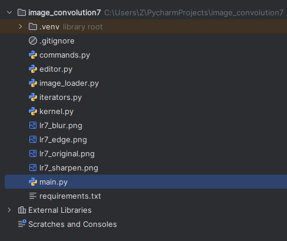
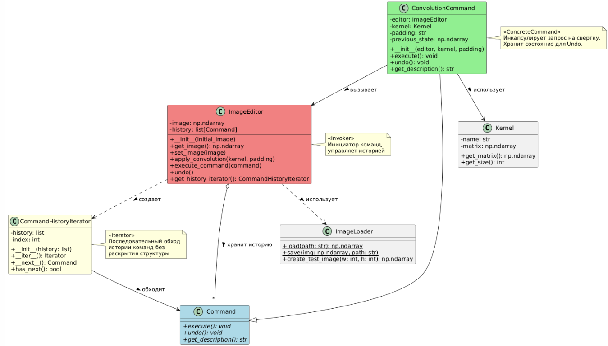
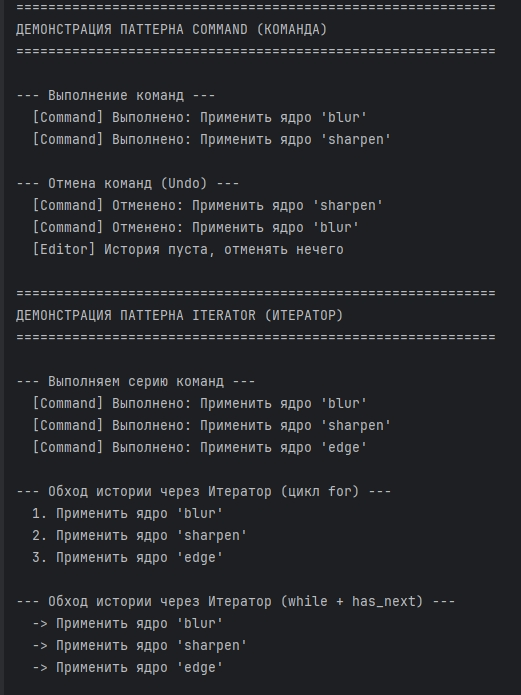
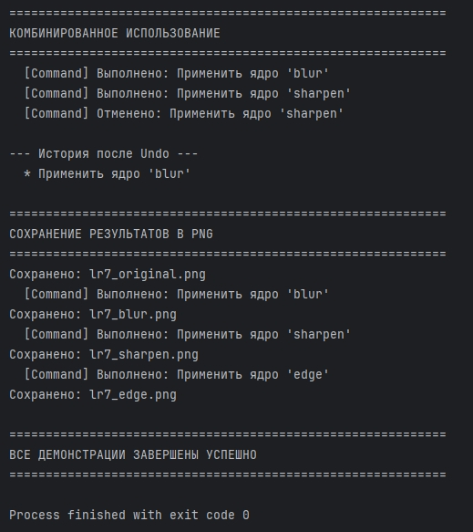

# Отчет к практической работе № 7

### Цель работы

реализуйте решение задачи из предметной области с использованием паттернов из списка: «Команда», «Итератор / Индикатор».

## **Ход работы:**

Вариант 5.

Разработка приложения «Свертка изображения».

Паттерн «Команда» (Command).

В интерактивном редакторе изображений нужно не только применять эффекты, но и иметь возможность их отменять (Undo/Redo), а также записывать макросы (последовательности действий). Прямой вызов методов смешивает логику выполнения и логику интерфейса.

Нужно инкапсулировать каждую операцию свертки в объект-команду (ConvolutionCommand). Команда хранит состояние для отмены и может быть поставлена в очередь.

Паттерн «Итератор» (Iterator).

Редактор хранит историю выполненных команд. Нужно иметь возможность последовательно обходить эту историю (например, для вывода лога операций или анализа), не раскрывая внутреннюю структуру хранения (стек/список).

Поэтому можно реализовать собственный итератор CommandHistoryIterator, который предоставляет стандартный интерфейс для пошагового обхода истории команд.

Диаграмма включает следующие классы:

Command – интерфейс команды с тремя абстрактными методами: execute() для выполнения операции, undo() для отмены и get_description() для получения описания команды.

ConvolutionCommand (Команда) – конкретная команда, инкапсулирующая запрос на применение свертки к изображению. Хранит ссылку на редактор (editor: ImageEditor), ядро свертки (kernel: Kernel), тип padding (padding: str) и предыдущее состояние изображения (previous_state: np.ndarray) для поддержки отмены. Реализует методы execute(), undo() и get_description().

ImageEditor (Совместное применение) – инициатор команд, управляющий текущим изображением (image: np.ndarray) и историей выполненных команд (history: list[Command]). Предоставляет методы get_image(), set_image(), apply_convolution() для работы с изображением, execute_command() для выполнения и записи команд в историю, undo() для отмены последней команды и get_history_iterator() для получения итератора истории.

CommandHistoryIterator (Итератор) – итератор для последовательного обхода истории команд без раскрытия её внутренней структуры (списка). Хранит ссылку на историю (history: list) и текущий индекс (index: int). Реализует протокол итератора Python через методы __iter__(), __next__() и дополнительный метод has_next() для проверки наличия следующих элементов.

Kernel – класс ядра свертки, хранящий имя и матрицу весов. Предоставляет методы get_matrix() и get_size() для доступа к данным ядра.

ImageLoader – утилитарный класс для загрузки изображений из файла, сохранения в файл и создания тестовых изображений.

Отношения:

Реализация интерфейса: ConvolutionCommand реализует интерфейс Command (сплошная стрелка с треугольником).
Ассоциация: ConvolutionCommand использует ImageEditor для применения свертки (сплошная стрелка с надписью «вызывает»).
Ассоциация: ConvolutionCommand использует Kernel для получения матрицы ядра (сплошная стрелка с надписью «использует»).
Агрегация: ImageEditor хранит коллекцию объектов Command в истории (надпись «хранит историю»).
Создание: ImageEditor создает объект CommandHistoryIterator (пунктирная стрелка с надписью «создает»).
Итерация: CommandHistoryIterator обходит объекты Command (сплошная стрелка с надписью «обходит»).
Использование: ImageEditor использует ImageLoader для работы с файлами (пунктирная стрелка с надписью «использует»).
## **Исходный код:**

[https://github.com/kkirshenko/image_convolution](https://github.com/kkirshenko/image_convolution)

### Вывод

** **реализовано решение задачи из предметной области с использованием паттернов из списка: «Команда», «Итератор / Индикатор».

