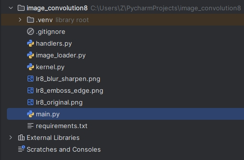
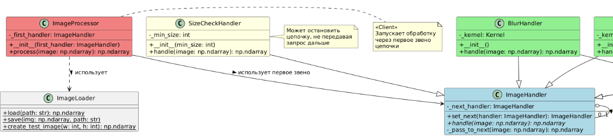
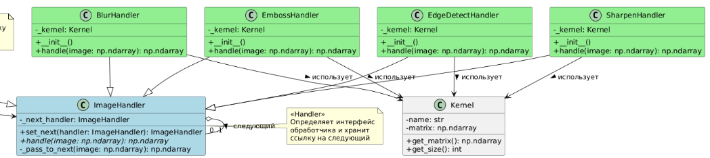
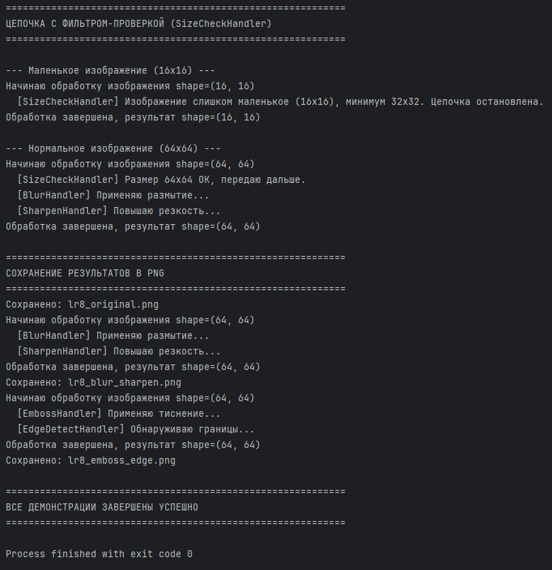

# Отчет к практической работе № 8

### Цель работы

реализуйте решение задачи из предметной области с использованием паттерна «Цепочка обязанностей».

## **Ход работы:**

Вариант 5.

Разработка приложения «Свертка изображения».

Паттерн «Цепочка обязанностей» позволяет передавать запрос последовательно по цепочке потенциальных обработчиков. Каждый обработчик решает, выполнить ли запрос или передать его следующему звену.

При обработке изображений часто требуется применить последовательность фильтров (например, размытие → повышение резкости → обнаружение границ). Жестко заданная последовательность негибка – нельзя динамически менять порядок или состав операций.

Потому каждый фильтр инкапсулирован в объект-обработчик (ImageHandler). Обработчики связываются в цепочку через set_next(). Клиент запускает обработку с первого звена, и изображение проходит через всю цепочку. Можно динамически собирать разные цепочки из одних и тех же обработчиков.

Диаграмма включает следующие классы:

ImageHandler (Handler) – абстрактный базовый класс обработчика. Определяет интерфейс для всех конкретных обработчиков с методом handle(image: np.ndarray) и хранит ссылку на следующий обработчик в цепочке (_next_handler: ImageHandler). Предоставляет метод set_next() для связывания обработчиков и вспомогательный метод _pass_to_next() для передачи запроса следующему звену.

Конкретные обработчики:

BlurHandler – применяет размытие изображения, содержит _kernel: Kernel.
EmbossHandler – применяет эффект тиснения, содержит _kernel: Kernel.
EdgeDetectHandler – обнаруживает границы, содержит _kernel: Kernel.
SharpenHandler – повышает резкость, содержит _kernel: Kernel.
SizeCheckHandler – специальный обработчик-фильтр, проверяющий минимальный размер изображения (_min_size: int). Может остановить цепочку, не передавая запрос дальше, если изображение слишком маленькое.

ImageProcessor (Client) — клиентский класс, запускающий обработку. Хранит ссылку на первое звено цепочки (_first_handler: ImageHandler) и предоставляет метод process() для начала обработки изображения.

Kernel – вспомогательный класс ядра свертки, хранящий имя (name: str) и матрицу весов (matrix: np.ndarray). Предоставляет методы get_matrix() и get_size() для доступа к данным ядра.

ImageLoader – утилитарный класс для загрузки, сохранения и создания тестовых изображений.

Отношения:

Наследование: все конкретные обработчики (BlurHandler, EmbossHandler, EdgeDetectHandler, SharpenHandler, SizeCheckHandler) наследуются от абстрактного ImageHandler (сплошные стрелки с треугольником).
Самоагрегация (цепочка): ImageHandler содержит ссылку на следующий ImageHandler (ромб с надписью «следующий»), что позволяет строить цепочку произвольной длины.
Использование первого звена: ImageProcessor использует первое звено цепочки (пунктирная стрелка с надписью «использует первое звено»).
Использование Kernel: все конкретные обработчики используют класс Kernel для получения матрицы свертки (сплошные стрелки с надписью «использует»).
Использование ImageLoader: ImageProcessor использует ImageLoader для работы с файлами (пунктирная стрелка с надписью «использует»).
## **Исходный код:**

[https://github.com/kkirshenko/image_convolution](https://github.com/kkirshenko/image_convolution)

### Вывод

** **реализовано решение задачи из предметной области с использованием паттерна «Цепочка обязанностей».

