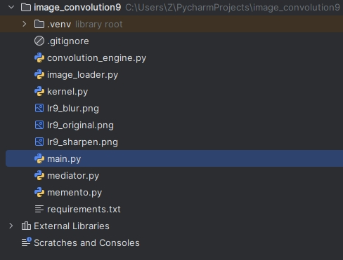
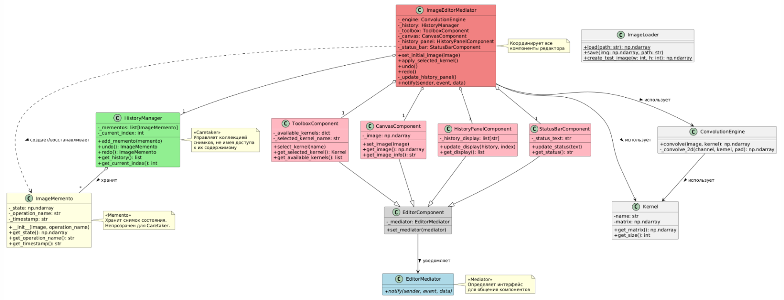
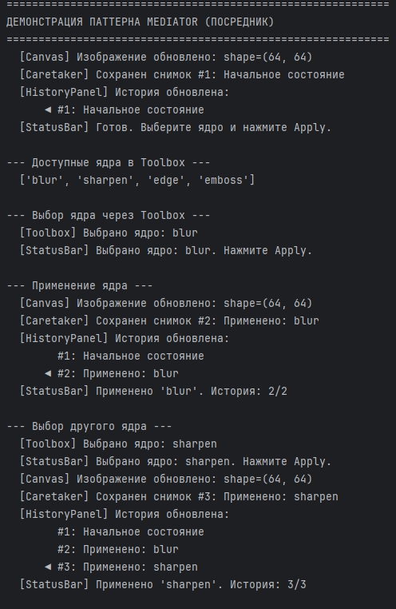
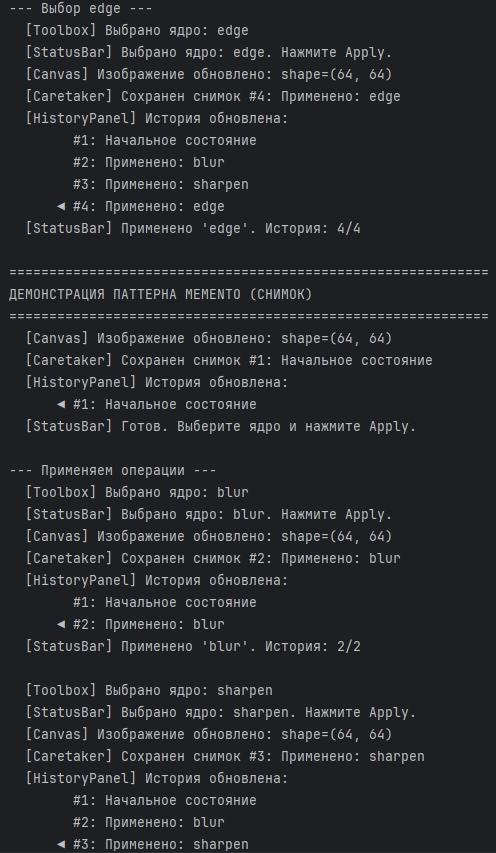
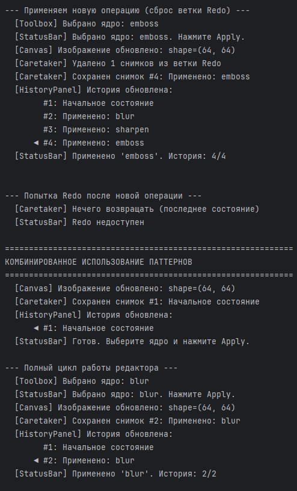
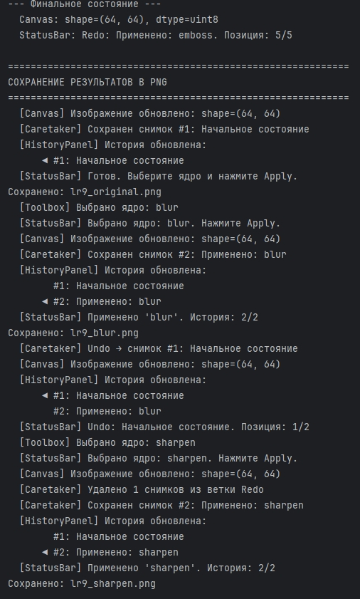

# Отчет к практической работе № 9

### Цель работы

реализуйте решение задачи из предметной области с использованием паттернов из списка: «Посредник», «Снимок».

## **Ход работы:**

Вариант 5.

Разработка приложения «Свертка изображения».

Паттерн «Посредник» (Mediator).

В интерактивном редакторе изображений есть несколько компонентов (панель инструментов, холст, панель истории, статус-бар), которые должны взаимодействовать.

Прямые связи между ними создают «паутину» зависимостей – добавление нового компонента требует изменения всех остальных.

Поэтому создается объект-посредник ImageEditorMediator, через который компоненты общаются друг с другом. Каждый компонент знает только о посреднике, но не о других компонентах.

Паттерн «Снимок» (Memento).

Нужно сохранять состояние изображения для поддержки Undo/Redo, но нельзя нарушать инкапсуляцию редактора (состояние – приватное).

ImageMemento хранит снимок состояния изображения. ImageEditor (Originator) создает и восстанавливает снимки. HistoryManager (Caretaker) хранит коллекцию снимков, не имея доступа к их внутренностям.

Диаграмма включает следующие классы:

Диаграмма демонстрирует реализацию паттернов Посредник (Mediator) и Снимок (Memento) в приложении «Свертка изображения».

Центральным элементом выступает класс ImageEditorMediator (красный), который координирует все компоненты редактора. Он агрегирует по одному экземпляру каждого компонента – ToolboxComponent, CanvasComponent, HistoryPanelComponent, StatusBarComponent – а также хранитель истории HistoryManager.

Все компоненты наследуются от абстрактного класса EditorComponent и хранят ссылку на посредника, через который они уведомляют об изменениях (метод notify). Сам посредник реализует интерфейс EditorMediator.

Паттерн Снимок реализован через пару классов: ImageMemento хранит снимок состояния изображения и непрозрачен для внешних объектов, а HistoryManager (Caretaker) управляет коллекцией снимков и поддерживает операции Undo/Redo через индекс текущего состояния. Посредник создает и восстанавливает снимки, delegируя хранение менеджеру истории.

Вспомогательные классы ConvolutionEngine, Kernel и ImageLoader (серые) используются посредником для выполнения свертки и работы с файлами.

## **Исходный код:**

[https://github.com/kkirshenko/image_convolution](https://github.com/kkirshenko/image_convolution)

### Вывод

** **реализовано решение задачи из предметной области с использованием паттернов из списка: «Посредник», «Снимок».

