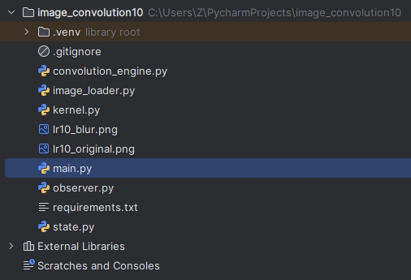
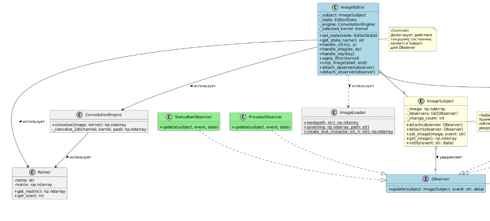
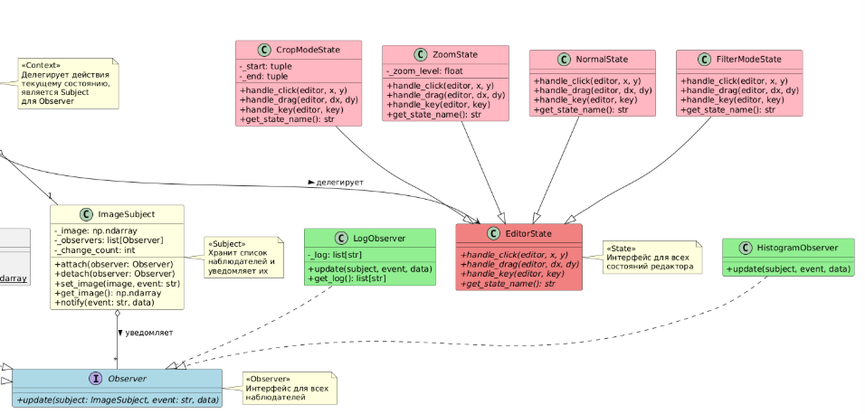
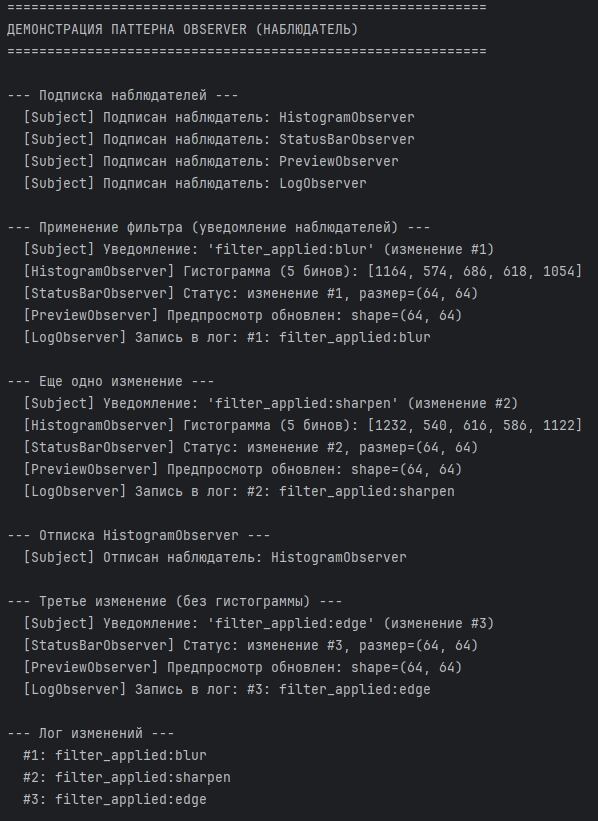
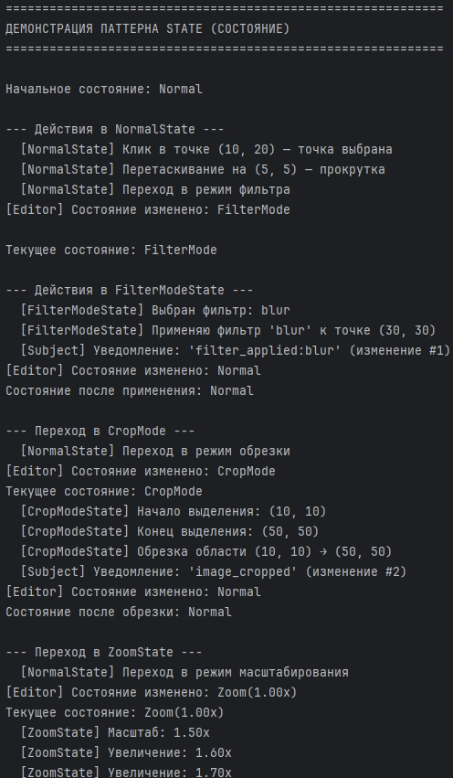
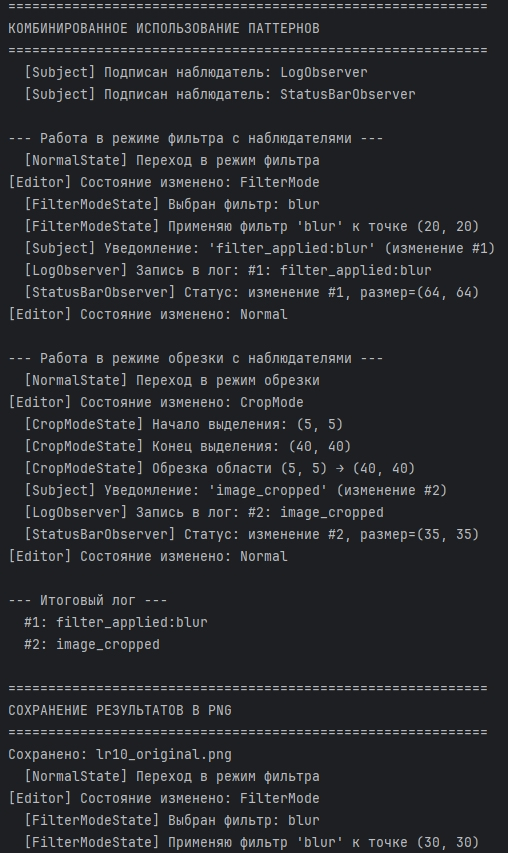
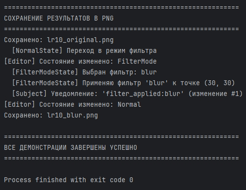

# Отчет к практической работе № 10

### Цель работы

реализуйте решение задачи из предметной области с использованием паттернов из списка: «Наблюдатель», «Состояние».

## **Ход работы:**

Вариант 5.

Разработка приложения «Свертка изображения».

Паттерн «Наблюдатель» (Observer).

При обработке изображения нужно синхронно обновлять несколько связанных компонентов – гистограмму, панель предпросмотра, статус-бар, лог операций. Прямые ссылки между ними создают жесткие зависимости: добавление нового наблюдателя требует изменения кода изображения.

ImageSubject (изображение) хранит список подписчиков (Observer) и уведомляет их об изменениях через метод notify(). Каждый наблюдатель реализует общий интерфейс и реагирует на изменения независимо.

Паттерн «Состояние» (State).

Редактор изображений имеет несколько режимов работы (обычный, применение фильтра, обрезка, масштабирование). Поведение одних и тех же действий (клик, перетаскивание) зависит от текущего режима. Реализация через if/elif в каждом методе приводит к громоздкому коду.

Каждый режим инкапсулирован в отдельный класс-состояние (EditorState). Контекст (ImageEditor) делегирует обработку действий текущему состоянию. Смена режима = смена объекта состояния без изменения кода контекста.

Диаграмма включает следующие классы:

Центральным элементом выступает класс ImageEditor, который делегирует обработку действий текущему состоянию и одновременно является Subject для паттерна Observer. Класс агрегирует текущее состояние EditorState, движок свертки, выбранное ядро и коллекцию наблюдателей.

Паттерн State реализован через абстрактный класс EditorState и четыре конкретных состояния: NormalState (обычный режим), FilterModeState (применение фильтра), CropModeState (обрезка) и ZoomState (масштабирование). Каждое состояние переопределяет методы обработки клика, перетаскивания и нажатия клавиш, что позволяет редактору менять поведение без условных операторов.

Паттерн Observer реализован через класс ImageSubject, который хранит список подписчиков и уведомляет их об изменениях изображения. Конкретные наблюдатели: StatusBarObserver (обновление статуса), PreviewObserver (предпросмотр), LogObserver (логирование), HistogramObserver (гистограмма) – реагируют на события независимо друг от друга.

Вспомогательные классы ConvolutionEngine, Kernel и ImageLoader обеспечивают базовую функциональность свертки и работы с файлами.

## **Исходный код:**

[https://github.com/kkirshenko/image_convolution](https://github.com/kkirshenko/image_convolution)

### Вывод

** **реализовано решение задачи из предметной области с использованием паттернов из списка: «Наблюдатель», «Состояние».

