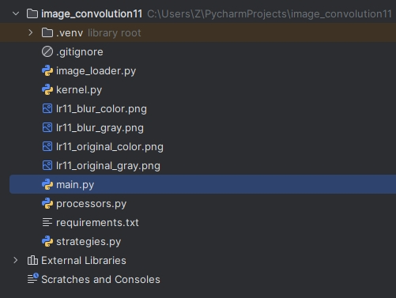
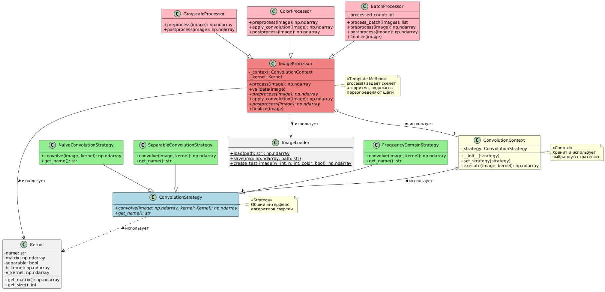
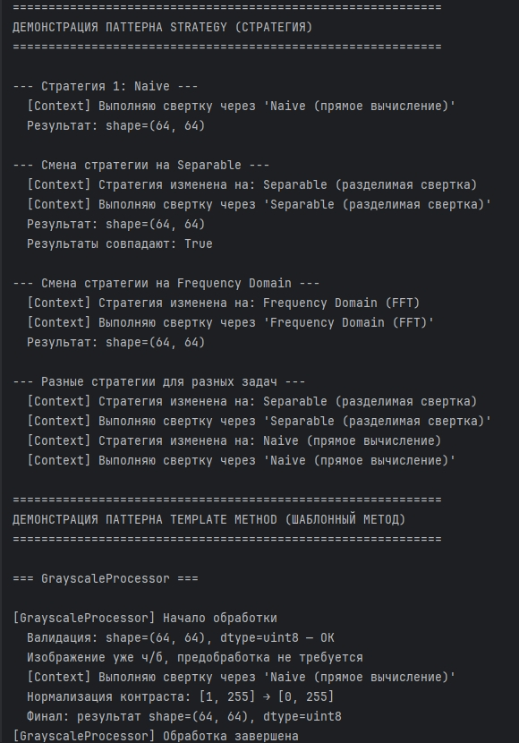
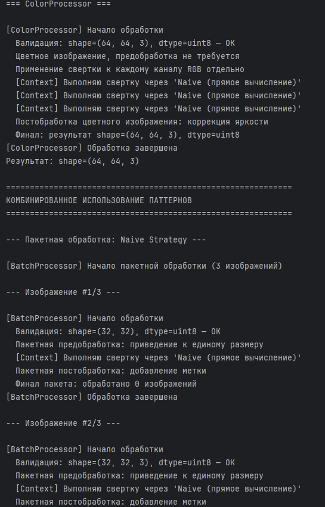
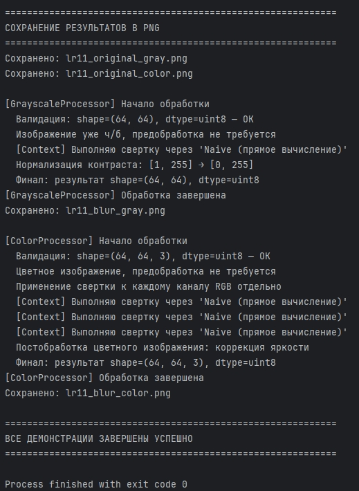

# Отчет к практической работе № 11

### Цель работы

реализуйте решение задачи из предметной области с использованием паттернов из списка: «Стратегия», «Шаблонный метод».

## **Ход работы:**

Вариант 5.

Разработка приложения «Свертка изображения».

Паттерн «Стратегия» (Strategy).

Свертку изображения можно выполнять разными алгоритмами – наивным, через разделимые ядра или в частотной области. Жесткое кодирование одного алгоритма не позволяет выбирать оптимальный под конкретную задачу.

Можно инкапсулировать каждый алгоритм свертки в отдельный класс-стратегию, реализующий общий интерфейс ConvolutionStrategy. Контекст ConvolutionContext использует выбранную стратегию, позволяя подменять алгоритм на лету.

Паттерн «Шаблонный метод» (Template Method).

Обработка изображений разных типов (ч/б, цветные, пакетная) имеет общую структуру: валидация → предобработка → применение свертки → постобработка → сохранение. Дублирование этого «скелета» в каждом обработчике ведет к ошибкам и усложняет поддержку.

Абстрактный класс ImageProcessor определяет шаблонный метод process(), задающий скелет алгоритма. Конкретные подклассы (GrayscaleProcessor, ColorProcessor, BatchProcessor) переопределяют только некоторые шаги (например, preprocess() или apply_convolution()), не меняя общую структуру.

Диаграмма включает следующие классы:

Паттерн Стратегия реализован через абстрактный класс ConvolutionStrategy и три конкретных алгоритма свертки (зеленые): NaiveConvolutionStrategy (прямое вычисление), SeparableConvolutionStrategy (разделимая свертка для оптимизации) и FrequencyDomainStrategy (свертка через FFT в частотной области). Контекст ConvolutionContext хранит ссылку на текущую стратегию и делегирует ей выполнение операции через метод execute(), позволяя подменять алгоритм на лету без изменения клиентского кода.

Паттерн Шаблонный метод реализован через абстрактный класс ImageProcessor, который определяет шаблонный метод process(), задающий скелет алгоритма обработки изображения: валидация → предобработка → применение свертки → постобработка → завершение. Конкретные подклассы переопределяют вариабельные шаги: GrayscaleProcessor работает с ч/б изображениями, ColorProcessor обрабатывает каждый RGB-канал отдельно, BatchProcessor реализует пакетную обработку множества изображений.

Вспомогательные классы Kernel и ImageLoader обеспечивают базовую функциональность работы с ядрами свертки и файлами изображений.

Отношения: стратегии и процессоры используют ConvolutionContext и Kernel для выполнения операций. ImageProcessor агрегирует контекст стратегии, что позволяет комбинировать любой тип обработки с любым алгоритмом свертки.

## **Исходный код:**

[https://github.com/kkirshenko/image_convolution](https://github.com/kkirshenko/image_convolution)

### Вывод

** **реализовано решение задачи из предметной области с использованием паттернов из списка: «Стратегия», «Шаблонный метод».

