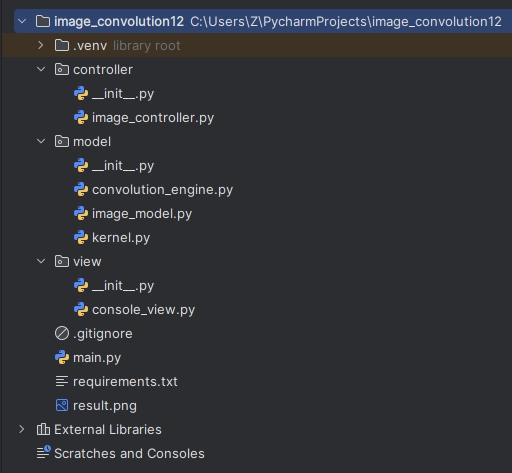
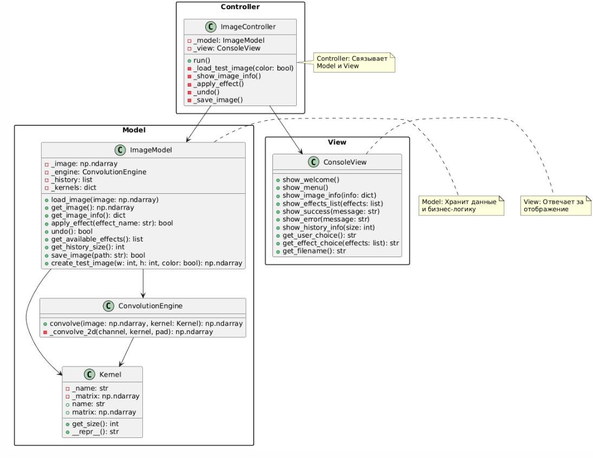
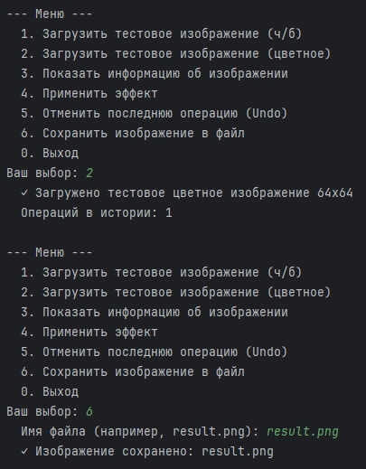
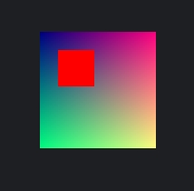

# Отчет к практической работе № 12

### Цель работы

реализуйте решение задачи из предметной области с использованием одного из паттернов из списка: MVC, MVP, MVVM, Clean Architecture.

## **Ход работы:**

Вариант 5.

Разработка приложения «Свертка изображения».

Был выбран паттерн MVC (Model-View-Controller), который разделяет приложение на три слоя:

Model – данные и бизнес-логика (изображение, ядра, движок свертки).

View – отображение данных (консольный интерфейс).

Controller – обработка действий пользователя, связь Model и View.

Диаграмма включает следующие классы:

Пакет Controller содержит класс ImageController, который выступает центральным связующим звеном. Он агрегирует экземпляры ImageModel и ConsoleView и содержит методы для обработки действий пользователя (run, _load_test_image, _apply_effect, _undo, _save_image и др.). Контроллер принимает ввод от View, вызывает соответствующие методы Model и передает результаты обратно для отображения.

Пакет Model инкапсулирует данные и бизнес-логику приложения. Класс ImageModel хранит текущее изображение, историю изменений и словарь доступных ядер. Для выполнения операций свертки он использует класс ConvolutionEngine, который оперирует объектами класса Kernel (хранящими имя и матрицу весов). Модель предоставляет методы для применения эффектов, отмены действий (undo) и сохранения, полностью независимые от способа отображения.

Пакет View содержит класс ConsoleView, отвечающий исключительно за отображение данных и получение ввода от пользователя через консольный интерфейс. Он включает методы для вывода приветствия, меню, информации об изображении, списков эффектов и сообщений об успехе или ошибках, а также методы для считывания выбора пользователя (get_user_choice, get_effect_choice).

Отношения между классами строго однонаправлены: контроллер управляет моделью и представлением, модель использует движок свертки и ядра, а представление не имеет прямых ссылок ни на модель, ни на контроллер. Такое разделение обеспечивает независимость слоев: например, консольный View можно заменить на графический без изменения кода Model и Controller.

## **Исходный код:**

[https://github.com/kkirshenko/image_convolution](https://github.com/kkirshenko/image_convolution)

### Вывод

** **реализовано решение задачи из предметной области с использованием паттерна MVC.

