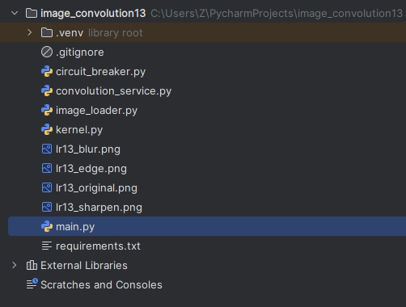
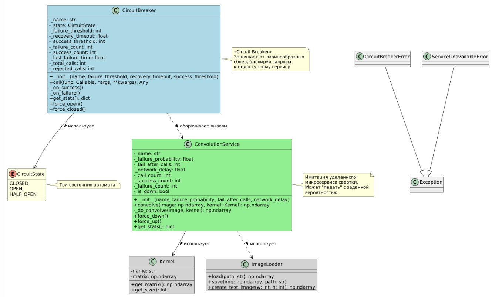
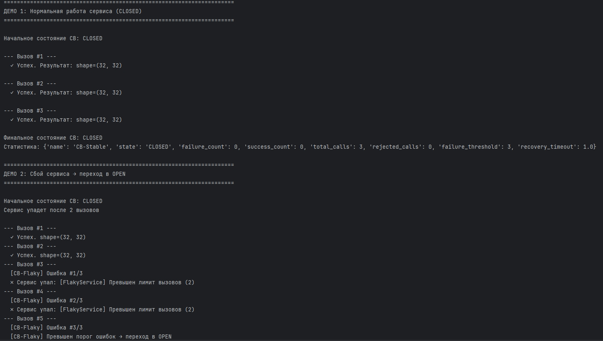
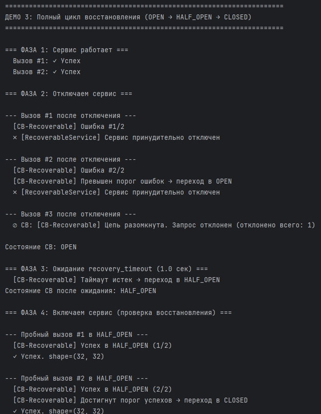
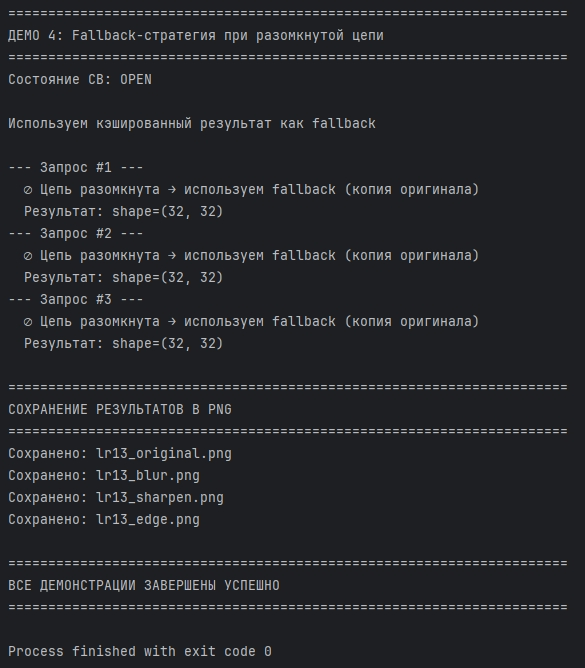

# Отчет к практической работе № 13

### Цель работы

реализуйте решение задачи из предметной области с использованием одного из паттернов из списка: Saga, CQRS, Event Sourcing, Circuit Breaker, API Gateway.

## **Ход работы:**

Вариант 5.

Разработка приложения «Свертка изображения».

Паттерн Circuit Breaker (Предохранитель) предотвращает лавинообразные сбои в распределённых системах, временно блокируя запросы к недоступному сервису.

В реальном приложении обработка изображений часто выносится в отдельный микросервис (например, из-за высоких требований к CPU/GPU). Если этот сервис падает или работает медленно, клиенты продолжают слать запросы, что:

Перегружает и без того проблемный сервис.
Блокирует потоки клиентов (таймауты).
Вызывает каскадный сбой всей системы.
Circuit Breaker решает эту проблему: при обнаружении сбоев он «размыкает цепь» и сразу возвращает ошибку (или fallback-результат), не дожидаясь таймаута. Периодически проверяет восстановление сервиса.

Три состояния автомата:

Closed – нормальная работа, запросы проходят.
Open – сервис недоступен, запросы блокируются сразу.
Half-Open – пробный запрос для проверки восстановления.

Диаграмма включает следующие классы:

CircuitBreaker – центральный класс паттерна, защищающий от лавинообразных сбоев при обращении к ненадежному сервису. Содержит параметры конфигурации (failure_threshold, recovery_timeout, success_threshold), счетчики вызовов (failure_count, success_count, total_calls, rejected_calls) и временные метки. Метод call() оборачивает вызов функции, автоматически переключая состояния автомата через методы _on_success() и _on_failure().

CircuitState – перечисление трех состояний автомата: CLOSED (нормальная работа, запросы проходят), OPEN (сервис недоступен, запросы блокируются), HALF_OPEN (пробный запрос для проверки восстановления).

ConvolutionService – имитация удаленного микросервиса свертки изображений. Поддерживает различные режимы сбоев: случайные ошибки с заданной вероятностью (failure_probability), отказ после определенного числа вызовов (fail_after_calls), принудительное отключение (force_down()). Использует классы Kernel для выполнения свертки и ImageLoader для работы с изображениями.

Kernel и ImageLoader – вспомогательные классы для работы с ядрами свертки и файлами изображений.

CircuitBreakerError и ServiceUnavailableError – классы исключений для обработки ошибок circuit breaker и недоступности сервиса.

## **Исходный код:**

[https://github.com/kkirshenko/image_convolution](https://github.com/kkirshenko/image_convolution)

### Вывод

**реализовано решение задачи из предметной области с использованием паттерна Circuit Breaker.**

