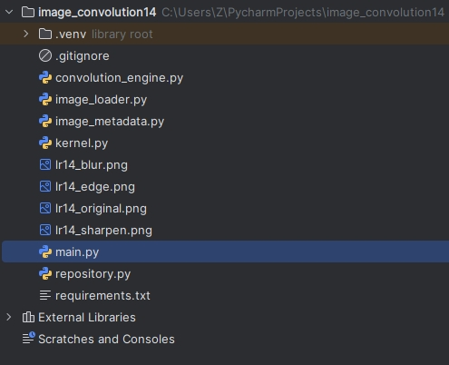
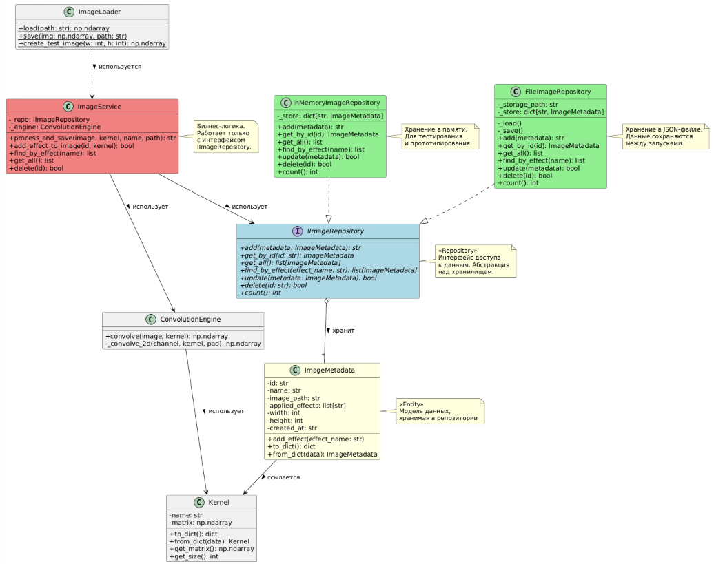
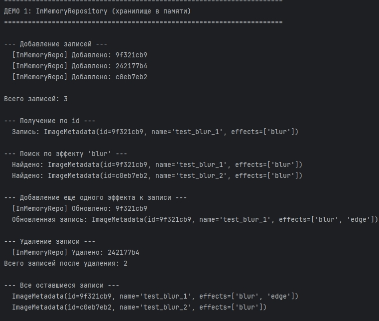
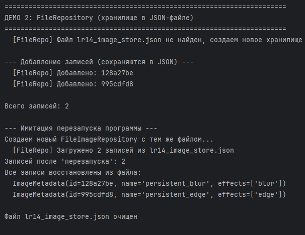
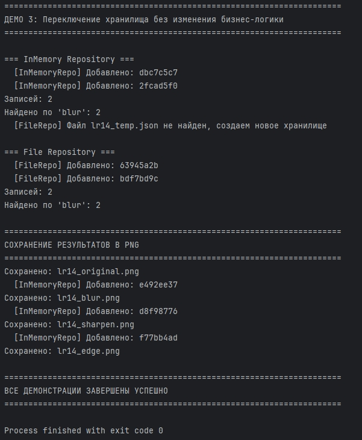

# Отчет к практической работе № 14

### Цель работы

реализуйте решение задачи из предметной области с использованием одного из паттернов из списка: Repository, Data Mapper, Active Record, Unit of Work.

## **Ход работы:**

Вариант 5.

Разработка приложения «Свертка изображения».

Паттерн «Repository» – посредник между слоем бизнес-логики и слоем хранения данных, имитирующий коллекцию объектов в памяти.

В приложении обработки изображений возникает задача персистентности: нужно сохранять результаты обработки, метаданные (какие эффекты применялись, параметры, дата), и иметь возможность их искать, фильтровать и восстанавливать.

Интерфейс IImageRepository с методами CRUD. Бизнес-логика работает только с ним, не зная, где реально хранятся данные – в памяти, в JSON-файле или в SQLite. При необходимости хранилище меняется одной строкой.

Диаграмма включает следующие классы:

Центральным элементом выступает интерфейс IImageRepository, определяющий абстракцию над хранилищем данных. Он предоставляет стандартный набор CRUD-операций (add, get_by_id, get_all, update, delete, count) и специализированный метод поиска find_by_effect(). Интерфейс реализуют два конкретных класса: InMemoryImageRepository – хранит данные в словаре в памяти и предназначен для тестирования и прототипирования, и FileImageRepository – сохраняет данные в JSON-файле, обеспечивая персистентность между запусками программы через методы _load() и _save().

ImageService – сервисный слой бизнес-логики, который агрегирует интерфейс IImageRepository и движок ConvolutionEngine. Предоставляет методы process_and_save(), add_effect_to_image(), find_by_effect(), delete(). Ключевая особенность: сервис работает только с абстракцией IImageRepository, не завися от конкретной реализации хранилища.

ImageMetadata – модель данных, хранимая в репозитории. Содержит идентификатор, имя, путь к файлу, список примененных эффектов, размеры изображения и дату создания. Поддерживает сериализацию через методы to_dict() и from_dict().

Вспомогательные классы Kernel, ConvolutionEngine и ImageLoader обеспечивают базовую функциональность свертки и работы с файлами.

Отношения:

InMemoryImageRepository и FileImageRepository реализуют интерфейс IImageRepository (пунктирные стрелки).
ImageService агрегирует IImageRepository и использует ConvolutionEngine.
IImageRepository хранит коллекцию объектов ImageMetadata (кратность *).
ImageMetadata ссылается на Kernel для хранения информации о примененных ядрах.
ImageService использует ImageLoader для работы с файлами.

## **Исходный код:**

[https://github.com/kkirshenko/image_convolution](https://github.com/kkirshenko/image_convolution)

### Вывод

** **реализовано решение задачи из предметной области с использованием паттерна Repository.

