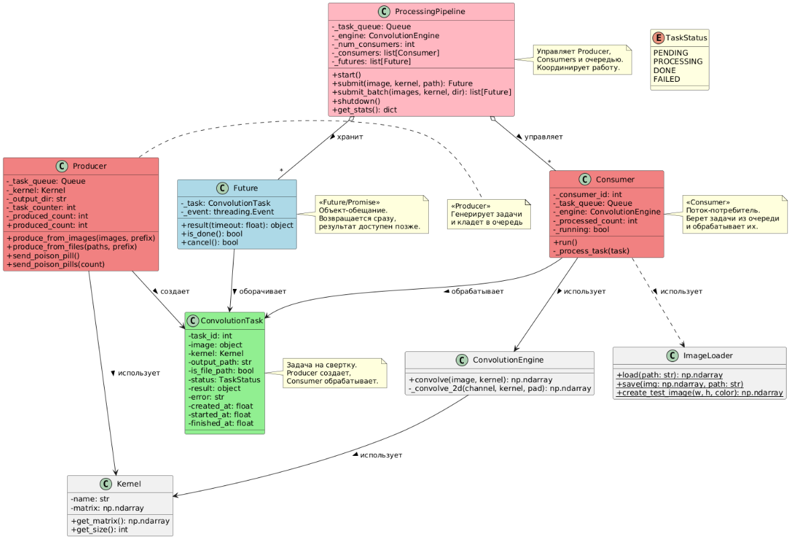
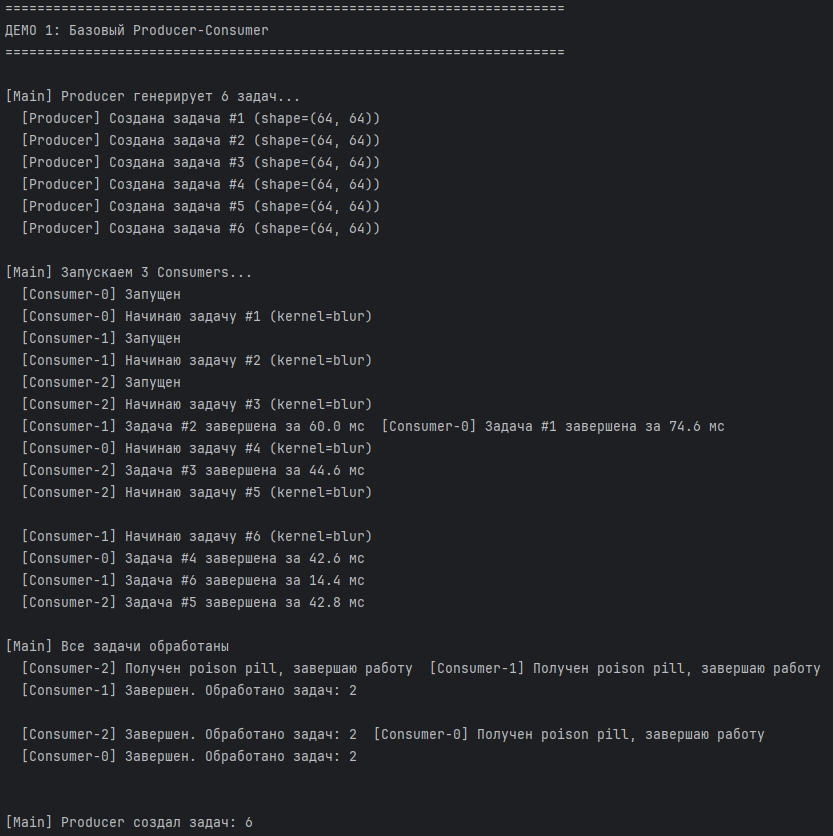
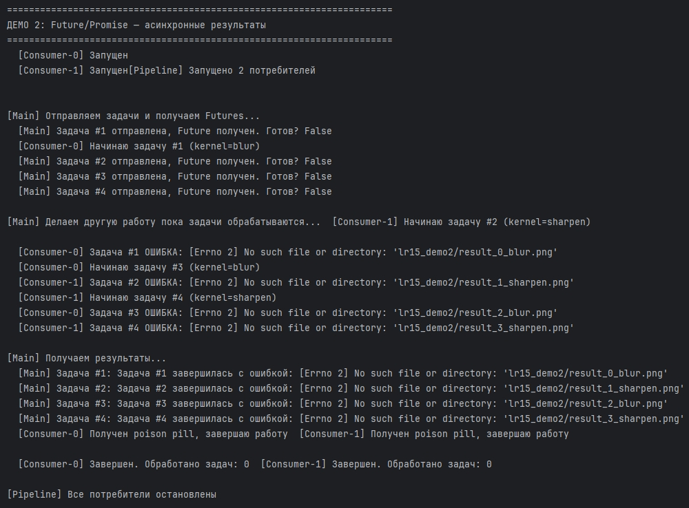
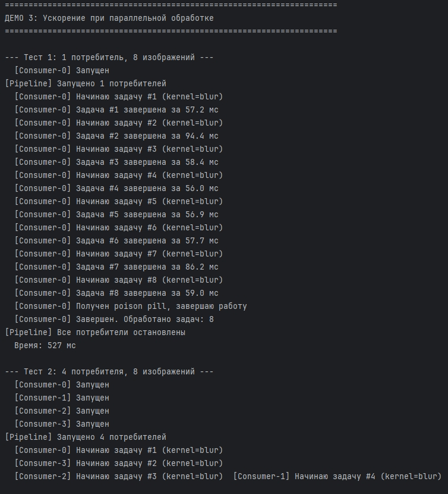
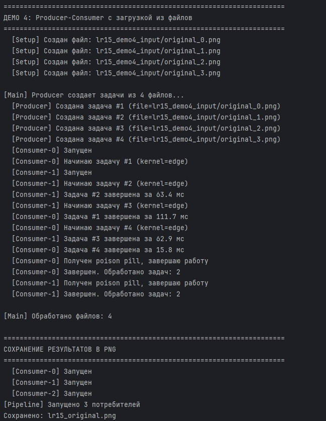
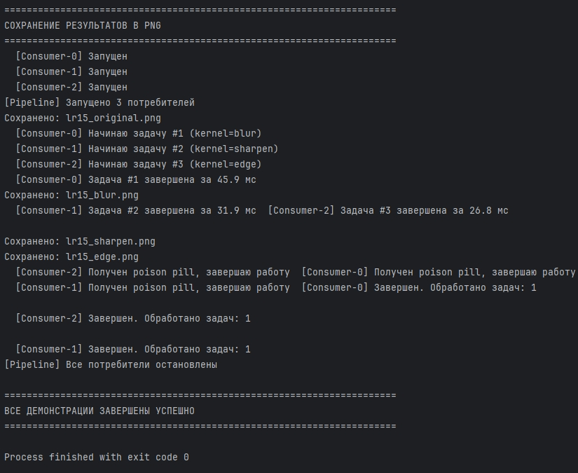

# Отчет к практической работе № 15

### Цель работы

реализуйте решение задачи из предметной области с использованием одного из паттернов из списка: ProducerConsumer, Thread Pool, Future / Promise.

## **Ход работы:**

Вариант 5.

Разработка приложения «Свертка изображения».

Паттерн «Producer-Consumer» (Производитель-Потребитель) – один из фундаментальных паттернов многопоточного программирования. Один поток (Producer) генерирует задачи и складывает их в очередь, другие потоки (Consumers) забирают задачи и обрабатывают их.

Обработка изображений – ресурсоемкая операция (CPU-bound). При пакетной обработке множества изображений последовательное выполнение неэффективно. Producer-Consumer позволяет:

Распараллелить обработку между несколькими потоками-потребителями.
Разделить ответственность: один компонент генерирует задачи, другие – выполняют.
Балансировать нагрузку: очередь автоматически распределяет задачи между свободными потребителями.
Масштабироваться: увеличение числа потребителей ускоряет обработку.
Дополнительно демонстрируется паттерн Future/Promise – объект-обещание, который возвращается сразу после отправки задачи, а результат становится доступен позже.

Диаграмма включает следующие классы:

Центральным координатором выступает класс ProcessingPipeline, который управляет очередью задач, запускает потоки-потребители и хранит объекты-обещания.

Класс Producer генерирует задачи на свертку (ConvolutionTask) и помещает их в общую очередь, используя ядра (Kernel).

Класс Consumer представляет собой поток-потребитель, который забирает задачи из очереди и обрабатывает их с помощью ConvolutionEngine и ImageLoader.

Паттерн Future/Promise реализован через класс Future, который оборачивает задачу ConvolutionTask и позволяет основному потоку получить результат асинхронно, не блокируя выполнение. Статусы задач отслеживаются через перечисление TaskStatus.

Разделение генерации и обработки задач позволяет параллельно выполнять свертку множества изображений, масштабируя систему добавлением потребителей, а механизм Future обеспечивает удобное асинхронное получение результатов без блокировки основного потока.

## **Исходный код:**

[https://github.com/kkirshenko/image_convolution](https://github.com/kkirshenko/image_convolution)

### Вывод

** **реализовано решение задачи из предметной области с использованием паттерна Producer-Consumer.

